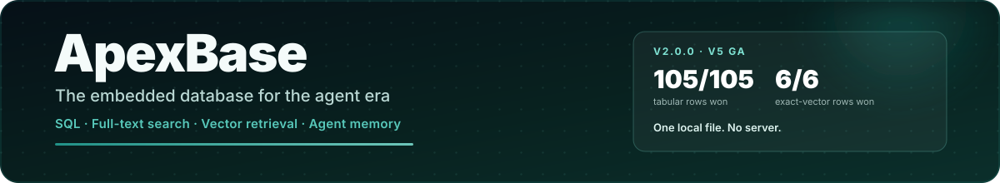
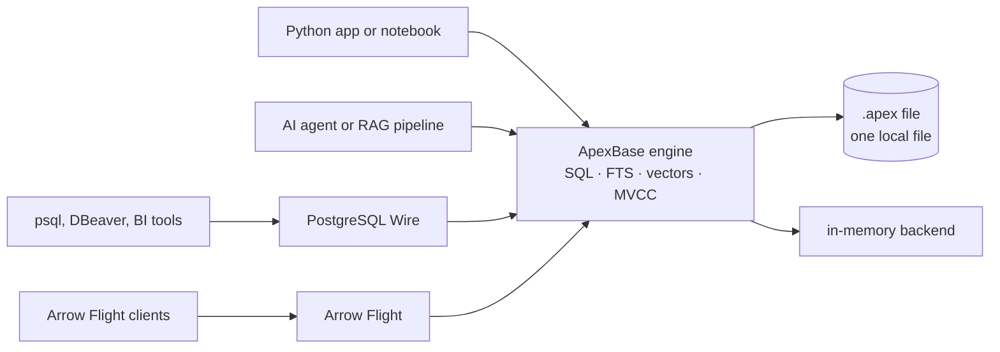

<div align="center">



<p>
  <a href="https://pypi.org/project/apexbase/"></a>
  <a href="https://pypi.org/project/apexbase/"></a>
  <a href="https://pypi.org/project/apexbase/"></a>
  <a href="https://github.com/BirchKwok/ApexBase/releases/tag/v2.1.0"></a>
  <a href="LICENSE"></a>
  <a href="https://birchkwok.github.io/apexbase/"></a>
</p>

**One Rust engine, one local file: analytical SQL, full-text search, vector retrieval, and agent memory.**
No database server. No separate search or vector service. Python, PostgreSQL Wire, and Arrow Flight interfaces.

[Quickstart](https://birchkwok.github.io/apexbase/latest/QUICK_START/) ·
[Agent memory](https://birchkwok.github.io/apexbase/latest/user-guide/agent-memory/) ·
[What's new in 2.0](https://birchkwok.github.io/apexbase/latest/whats-new-2.0/) ·
[Docs](https://birchkwok.github.io/apexbase/) ·
[Performance](https://birchkwok.github.io/apexbase/latest/performance/)

</div>

> **v2.1.0 is a correctness release on the V5 GA line.** It keeps the vector
> fast path usable across SQL `UPDATE`, makes `UPDATE ... SET vec = NULL` really
> assign NULL (and excludes NULL vectors from TopK), clears full-text and
> persisted vector state when a table is dropped, and fixes recreating several
> tables after a multi-table `DROP`. The on-disk format is unchanged, so it is a
> drop-in upgrade from 2.0.0. Read the
> [2.1 release notes](https://birchkwok.github.io/apexbase/latest/release-notes/).

## Why ApexBase

| You are building | ApexBase gives you |
| --- | --- |
| **An AI agent or RAG pipeline** | Persistent agent memory with BM25 + vector fusion, SQL metadata filters, and a single `.apex` file you can copy or back up |
| **Local analytics** | Columnar scans, joins, CTEs, windows, set operations, aggregations, and DataFrame round-trips without a warehouse |
| **An HTAP application** | Fast ingest, point reads, analytical SQL, MVCC transactions, and durable writes in one embedded engine |
| **A tool that needs a database** | PostgreSQL Wire for psql/DBeaver/BI clients and Arrow Flight for columnar transports, both from the same files |
| **A long-running service** | Per-query memory budgets, process admission control, out-of-core spill, and `execute_stream()` for bounded results |
| **A Rust or Python codebase** | A Rust core with a Python-first API, PyArrow-native results, and a Rust embedded API when you need it |

## Quickstart: give your agent a memory

Install once:

```bash
pip install apexbase
```

Then keep agent memories, retrieve them with hybrid search, and query them with
SQL. Everything lives in one local directory:

```python
from apexbase import ApexClient

with ApexClient("./agent-memory") as db:
    if "memories" not in db.list_tables():
        db.execute("""
            CREATE TABLE memories (
                content TEXT,
                source TEXT,
                created_at TEXT,
                embedding FLOAT16_VECTOR
            )
        """)
        db.execute("CREATE FTS INDEX ON memories(content)")
    db.use_table("memories")

    db.store([
        {"content": "User prefers dark mode and concise answers.",
         "source": "profile", "created_at": "2026-11-04T09:00:00Z",
         "embedding": [0.10, 0.82, 0.20]},
        {"content": "Deploys run Fridays at 17:00 UTC.",
         "source": "ops", "created_at": "2026-11-04T09:10:00Z",
         "embedding": [0.30, 0.40, 0.85]},
        {"content": "Retrieval should combine BM25 with embedding similarity.",
         "source": "notes", "created_at": "2026-11-04T09:20:00Z",
         "embedding": [0.16, 0.74, 0.58]},
    ])

    # BM25 recall + cosine ranking fused in one native call.
    hits = db.hybrid_search(
        [0.28, 0.42, 0.84], "deploy schedule",
        k=3, vector_col="embedding", metric="cosine",
    )
    for row in db.retrieve_many([int(i) for i in hits.get_ids()]).to_dict():
        print("-", row["content"])
```

That is the agent-memory pattern: embeddings from your model, BM25 from the
same engine, SQL for scope and recency, and no second database to operate. The
[Agent Memory & RAG guide](https://birchkwok.github.io/apexbase/latest/user-guide/agent-memory/)
adds tool-calling wrappers, forgetting, multi-session scoping, and memory limits.

## Or: local analytics in a few lines

```python
import pandas as pd
from apexbase import ApexClient

events = pd.DataFrame({
    "event": ["signup", "click", "purchase", "click", "signup"],
    "value": [0.0, 2.5, 29.9, 1.2, 0.0],
    "day": ["2026-01-01", "2026-01-02", "2026-01-02", "2026-01-03", "2026-01-04"],
})

with ApexClient(":memory:") as db:
    db.from_pandas(events, table_name="events")
    print(db.execute("""
        SELECT event, COUNT(*) AS n, ROUND(AVG(value), 2) AS avg_value
        FROM events
        WHERE day >= '2026-01-02'
        GROUP BY event
        ORDER BY n DESC
    """).to_pandas())
```

Results hand off directly to Pandas, Polars, or PyArrow. Use a filesystem path
for persistence or `ApexClient(":memory:")` for a true process-local database
that creates no files, including no WAL, catalog, or index files.

<details>
<summary><b>Or: zero-setup SQL for a script</b></summary>

```python
import apexbase

apexbase.execute("CREATE TABLE metrics (name TEXT, value DOUBLE)")
apexbase.execute("INSERT INTO metrics VALUES ('p95', 4.2), ('p99', 9.8)")
print(apexbase.execute("SELECT AVG(value) AS avg FROM metrics").scalar())
```

Module-level calls share one lazily created in-memory connection in the current
process. Use an explicit `ApexClient` when you need lifecycle control or
persistence.

</details>

## Why not assemble three systems?

The usual local AI stack is a database for metadata, a search engine for BM25, a
vector store for embeddings, and glue code to keep them consistent. ApexBase
puts all four in one engine and one file:

| Layer | Typical stack | ApexBase |
| --- | --- | --- |
| **Structured data and SQL** | SQLite or DuckDB | One embedded HTAP engine |
| **Full-text search** | FTS5, Meilisearch, Elasticsearch | Native BM25 + `MATCH()` in SQL |
| **Embeddings** | FAISS, sqlite-vector, pgvector | Float32/Float16/BFloat16/Int8/UInt8/1Bit/TurboQuant columns |
| **Fusion and filters** | Application glue + re-query | `hybrid_search()` or one SQL statement |
| **Serving** | Separate search/vector services | No server; optional PG Wire and Arrow Flight |
| **Consistency** | Multiple copies to keep in sync | One MVCC engine, one file generation |

ApexBase is an embedded engine, not a distributed search cluster. That is the
point: for an agent, a notebook, a desktop app, or a single-node service, the
database should be a file, not a fleet.

## Performance snapshot

Public baseline: **1,000,000 rows**, **1,000,000 Float32 vectors × 128 dims**,
2 warmups, 5 timed iterations, result cache disabled, median of three retained
same-machine runs (Apple arm64, Python 3.12). ApexBase won all **105 tabular metrics**
and all **6 exact-vector rows** in this baseline.

| Workload (median) | ApexBase | SQLite | DuckDB | vs best competitor |
| --- | ---: | ---: | ---: | ---: |
| `COUNT(*)` | 0.08 ms | 8.45 ms | 0.55 ms | 6.9× faster |
| Filter `name = 'user_5000'` | 0.19 ms | 46.64 ms | 1.64 ms | 8.5× faster |
| `GROUP BY` + `HAVING` | 0.68 ms | 362.4 ms | 3.81 ms | 5.6× faster |
| `ORDER BY ... LIMIT 100` | 1.99 ms | 55.58 ms | 5.68 ms | 2.9× faster |
| Bulk insert (1M rows) | 246 ms | 1,001 ms | 165.7 s | 4.1× faster |
| FTS index build | 1.82 ms | 1,637 ms | 1,230 ms | 675× faster |
| Vector TopK cosine (single) | 5.75 ms | 169.1 ms | 49.5 ms | 8.6× faster |
| Vector batch TopK L2 (10) | 50.0 ms | 1,403 ms | 352.7 ms | 7.1× faster |

Benchmarks are workload-sensitive. Reproduce them with
`python benchmarks/bench_vs_sqlite_duckdb.py`, and read the retained setup,
per-workload scoreboard, 10M-row scale checks, and quantized recall numbers in
the [Performance documentation](https://birchkwok.github.io/apexbase/latest/performance/).

## Architecture



One engine serves embedded Python and Rust, PostgreSQL Wire, and Arrow Flight.
Storage is columnar with compressed frames, delta/overlay visibility, and MVCC;
data is never duplicated into a separate search or vector service.

## Interfaces

| Interface | Use it when | Entry point |
| --- | --- | --- |
| **Python API** | Embedded apps, notebooks, agents, data pipelines | `ApexClient(path)` / `ApexClient(":memory:")` |
| **Process-local SQL** | Short scripts with no setup | `from apexbase import execute` |
| **Rust API** | Native Rust integration without Python | `apexbase::embedded::ApexDB` |
| **PostgreSQL Wire** | psql, DBeaver, DataGrip, BI tools, libpq clients | `apexbase-server` or `apexbase-serve` |
| **Arrow Flight** | Fast columnar transfer into Arrow-native systems | `apexbase-flight` or `apexbase-serve` |

## What's new in 2.0

- **Stable storage format 5.** V5 builds read V4 files; `APEX_WIDTH_FIDELITY=0`
  writes the V4 layout when older readers must stay compatible.
- **A complete logical type system.** `uuid`, `decimal(p,s)`,
  `timestamp`/`timestamptz`/`date`/`time`/`interval`, `list<T>`, and explicit
  `extension<codec>` columns, with typed Arrow/Polars projection.
- **Bounded execution by design.** `APEX_QUERY_MEMORY_MB` caps per-query
  operators, `APEX_PROCESS_BUDGET_MB` adds process admission with a bounded
  queue, `ORDER BY`/`GROUP BY`/`DISTINCT`/`JOIN` spill to disk, and
  `execute_stream()` yields Arrow batches instead of materializing everything.
- **Closed SQL semantics gaps.** `DISTINCT *` deduplicates on visible columns,
  duplicate projection aliases are uniquified deterministically, `RIGHT JOIN`
  ordering is fixed, and transactions/`COPY ... FROM` use uniform routing.
- **Safer full-text search.** FTS snapshots and WAL generations are reconciled
  with the table on open; stale indexes are rejected explicitly.
- **Multi-process writes.** `_id` ranges are reserved from a shared on-disk
  high-water mark, so several processes can write one table.
- **Faster, broader retrieval.** A persisted IVF index, native hybrid ranking,
  and nine vector storage codecs with exact reranking from the source vector.

The full feature-by-feature guide, migration rules, and known limits are in
[What's new in 2.0](https://birchkwok.github.io/apexbase/latest/whats-new-2.0/);
the historical list is in the
[release notes](https://birchkwok.github.io/apexbase/latest/release-notes/).

## Documentation

**Start at <https://birchkwok.github.io/apexbase/>**

| Goal | Page |
| --- | --- |
| **Install and run** | [Installation](https://birchkwok.github.io/apexbase/latest/installation/) · [Quickstart](https://birchkwok.github.io/apexbase/latest/QUICK_START/) |
| **Build agent memory** | [Agent Memory & RAG](https://birchkwok.github.io/apexbase/latest/user-guide/agent-memory/) |
| **Learn the model** | [Core Concepts](https://birchkwok.github.io/apexbase/latest/concepts/) |
| **Use the Python API** | [Python Client](https://birchkwok.github.io/apexbase/latest/user-guide/python-client/) · [API Reference](https://birchkwok.github.io/apexbase/latest/API_REFERENCE/) |
| **Write SQL** | [SQL Guide](https://birchkwok.github.io/apexbase/latest/user-guide/sql/) |
| **Import data** | [Data Import](https://birchkwok.github.io/apexbase/latest/user-guide/data-import/) |
| **Expose database tools** | [Server Protocols](https://birchkwok.github.io/apexbase/latest/user-guide/server-protocols/) |
| **Search text and vectors** | [Full-Text Search](https://birchkwok.github.io/apexbase/latest/FTS_GUIDE/) · [Float16 Vectors](https://birchkwok.github.io/apexbase/latest/FLOAT16_VECTOR_GUIDE/) · [Vector Quantization](https://birchkwok.github.io/apexbase/latest/VECTOR_QUANTIZATION_GUIDE/) |
| **Embed from Rust** | [Rust Embedded API](https://birchkwok.github.io/apexbase/latest/RUST_EMBEDDED_API/) |
| **Understand internals** | [Storage Architecture](https://birchkwok.github.io/apexbase/latest/STORAGE_ARCHITECTURE/) · [Resource Ownership](https://birchkwok.github.io/apexbase/latest/RESOURCE_OWNERSHIP/) |

## Install

```bash
pip install apexbase
```

Requirements: Python 3.9+, Linux/macOS/Windows on x86_64 or ARM64. Building from
source needs a Rust toolchain and `maturin`:

```bash
git clone https://github.com/BirchKwok/ApexBase.git
cd ApexBase
python -m pip install maturin
maturin develop --release
```

## Development

```bash
maturin develop --release   # build the native extension
pytest                      # full Python suite
cargo test                  # full Rust suite
python -m mkdocs serve      # preview this documentation
```

The engineering constraints for changes (release builds, complete tests,
same-machine performance gates, benchmark baselines) are in
[AGENTS.md](AGENTS.md). The docs site source lives in [`docs/`](docs/).

## Interoperability

```python
from apexbase import ApexClient

# Arrow-native conversion to and from Lance.
with ApexClient("./data") as client:
    client.create_table("articles", schema={"title": "string", "body": "string"})
    client.store({
        "title": ["Agent memory", "Local analytics"],
        "body": ["Retrieval over long-term memory.", "SQL over local files."],
    })
    client.to_lance("./articles.lance")

with ApexClient("./imported") as client:
    client.from_lance("./articles.lance", table_name="articles")
    print(client.execute("SELECT * FROM articles").to_dict())
```

Parquet, CSV, JSON, Pandas, Polars, PyArrow, PostgreSQL clients, and Arrow
Flight consumers are supported without an extra service. The conversion path is
Arrow-native; each format still owns its on-disk layout.

## License

Apache-2.0. See [LICENSE](LICENSE).

<div align="center">

**If ApexBase fits your stack, star the repository and try the
[quickstart](https://birchkwok.github.io/apexbase/latest/QUICK_START/).**

</div>
