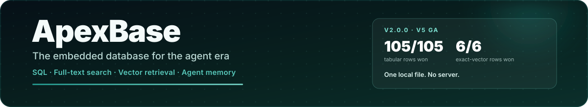

<p align="center">
  
</p>

<p align="center">
  <a href="https://pypi.org/project/apexbase/"></a>
  <a href="https://pypi.org/project/apexbase/"></a>
  <a href="https://github.com/BirchKwok/ApexBase/releases/tag/v2.0.0"></a>
  <a href="https://github.com/BirchKwok/ApexBase/blob/main/LICENSE"></a>
</p>

<h1 align="center">The embedded database for the agent era</h1>

<p align="center" class="apex-hero-caption">
  Analytical SQL, BM25 full-text search, vector retrieval, and agent memory in
  one Rust engine and one local <code>.apex</code> file. No server, no separate
  search or vector service, and direct hand-off to Pandas, Polars, and Arrow.
</p>

<p align="center">
  <a class="md-button md-button--primary" href="QUICK_START/">Get started in 5 minutes</a>
  <a class="md-button" href="user-guide/agent-memory/">Build agent memory</a>
  <a class="md-button" href="whats-new-2.0/">What's new in 2.0</a>
</p>

## Start here

<div class="grid cards" markdown>

-   :material-rocket-launch-outline: **Quickstart**

    ---

    Install the package, create a table, store records, run SQL, and convert the
    result to a DataFrame.

    [:octicons-arrow-right-24: Quickstart](QUICK_START.md)

-   :material-brain: **Agent Memory & RAG**

    ---

    Store agent memories with embeddings, fuse BM25 and vector ranking, and
    expose retrieval as a tool your model can call.

    [:octicons-arrow-right-24: Agent memory](user-guide/agent-memory.md)

-   :material-new-box: **What's new in 2.0**

    ---

    The V5 GA release: stable format 5, logical types, bounded execution,
    streaming results, and safer full-text search.

    [:octicons-arrow-right-24: Release highlights](whats-new-2.0.md)

-   :material-table-large: **SQL analytics**

    ---

    Joins, CTEs, windows, set operations, aggregations, and DataFrame imports
    without a warehouse or a server process.

    [:octicons-arrow-right-24: SQL guide](user-guide/sql.md)

-   :material-magnify: **Hybrid retrieval**

    ---

    Full-text search, vector TopK, quantized candidate generation, and exact
    reranking in the same engine as structured data.

    [:octicons-arrow-right-24: Search guides](FTS_GUIDE.md)

-   :material-server-network: **Database tools**

    ---

    Expose the same files through PostgreSQL Wire and Arrow Flight for psql,
    BI tools, and Arrow-native consumers.

    [:octicons-arrow-right-24: Server protocols](user-guide/server-protocols.md)

</div>

## Why ApexBase

| The common local stack | With ApexBase |
| --- | --- |
| SQLite/DuckDB for tables, FTS5 for text, FAISS or sqlite-vector for embeddings, plus glue to keep them consistent | One MVCC engine with SQL, BM25, and vector columns over the same rows |
| A server process, ports, and credentials for local search or vector retrieval | An embedded library; optional PG Wire and Arrow Flight only when a tool needs them |
| Materialized results that must fit in memory | Bounded operators, out-of-core spill, process admission control, and streaming Arrow batches |
| Re-embedding or re-copying data between systems | In-place updates, one file generation, and typed Arrow/Polars projections |
| A scratch project that stops at a demo | A stable on-disk format, release benchmarks, migration rules, and a documented limitations list |

## Quickstart

=== "Agent memory"

    ```python
    from apexbase import ApexClient

    with ApexClient("./agent-memory") as db:
        if "memories" not in db.list_tables():
            db.execute("""
                CREATE TABLE memories (
                    content TEXT, source TEXT,
                    created_at TEXT, embedding FLOAT16_VECTOR
                )
            """)
            db.execute("CREATE FTS INDEX ON memories(content)")
        db.use_table("memories")

        db.store([
            {"content": "User prefers dark mode.",
             "source": "profile", "created_at": "2026-11-04T09:00:00Z",
             "embedding": [0.10, 0.82, 0.20]},
            {"content": "Deploys run Fridays at 17:00 UTC.",
             "source": "ops", "created_at": "2026-11-04T09:10:00Z",
             "embedding": [0.30, 0.40, 0.85]},
        ])

        hits = db.hybrid_search(
            [0.28, 0.42, 0.84], "deploy schedule",
            k=2, vector_col="embedding", metric="cosine",
        )
        print(db.retrieve_many([int(i) for i in hits.get_ids()]).to_dict())
    ```

    The [Agent Memory & RAG guide](user-guide/agent-memory.md) covers tool
    wrappers, session scoping, forgetting, and memory limits.

=== "Analytics"

    ```python
    import pandas as pd
    from apexbase import ApexClient

    events = pd.DataFrame({
        "event": ["signup", "click", "purchase", "click"],
        "value": [0.0, 2.5, 29.9, 1.2],
        "day": ["2026-01-01", "2026-01-02", "2026-01-02", "2026-01-03"],
    })

    with ApexClient(":memory:") as db:
        db.from_pandas(events, table_name="events")
        print(db.execute("""
            SELECT event, COUNT(*) AS n, ROUND(AVG(value), 2) AS avg_value
            FROM events GROUP BY event ORDER BY n DESC
        """).to_pandas())
    ```

=== "In-memory SQL"

    ```python
    import apexbase

    apexbase.execute("CREATE TABLE metrics (name TEXT, value DOUBLE)")
    apexbase.execute("INSERT INTO metrics VALUES ('p95', 4.2), ('p99', 9.8)")
    print(apexbase.execute("SELECT AVG(value) FROM metrics").scalar())
    ```

## Performance at a glance

Public baseline: 1M rows, 1M × 128-dim vectors, 2 warmups + 5 timed
iterations, median of three same-machine runs on Apple arm64. ApexBase won
**105/105** tabular and **6/6** exact-vector comparison rows.

| Metric | ApexBase | Best competitor |
| --- | ---: | ---: |
| `COUNT(*)` | 0.08 ms | 0.55 ms (DuckDB) |
| Filter `name = 'user_5000'` | 0.19 ms | 1.64 ms (DuckDB) |
| `GROUP BY` + `HAVING` | 0.68 ms | 3.81 ms (DuckDB) |
| Bulk insert (1M rows) | 246 ms | 1,001 ms (SQLite) |
| Vector TopK cosine | 5.75 ms | 49.5 ms (DuckDB) |
| Vector batch TopK L2 | 50.0 ms | 352.7 ms (DuckDB) |

See [Performance](performance.md) for the full scoreboard, 10M-row checks, and
reproduction commands.

## v2.0.0 highlights

<div class="grid cards" markdown>

-   :material-harddisk: **Stable format 5**

    ---

    Format 5 is fixed for this release line. V5 builds read V4 files;
    `APEX_WIDTH_FIDELITY=0` writes the V4 layout for older readers.

-   :material-shape-outline: **Logical types**

    ---

    `uuid`, `decimal(p,s)`, the timestamp family, `list<T>`, and explicit
    extension codecs, all with typed Arrow and Polars projection.

-   :material-memory: **Bounded execution**

    ---

    Per-query budgets, process admission, out-of-core spill, and
    `execute_stream()` keep long-running agents inside a predictable memory
    ceiling.

-   :material-shield-search: **Safer retrieval**

    ---

    FTS generations are reconciled on open, stale indexes are rejected, and
    hybrid ranking fuses BM25 with vector search natively.

</div>

[:octicons-arrow-right-24: Read the full 2.0 release guide](whats-new-2.0.md)

## Documentation map

| Layer | Start with | Then |
| --- | --- | --- |
| **Getting started** | [Installation](installation.md) | [Quickstart](QUICK_START.md) · [Core Concepts](concepts.md) |
| **Build with it** | [Agent Memory & RAG](user-guide/agent-memory.md) | [Python Client](user-guide/python-client.md) · [SQL Guide](user-guide/sql.md) · [Data Import](user-guide/data-import.md) |
| **Search and vectors** | [Full-Text Search](FTS_GUIDE.md) | [Float16 Vectors](FLOAT16_VECTOR_GUIDE.md) · [Vector Quantization](VECTOR_QUANTIZATION_GUIDE.md) |
| **Expose it** | [Server Protocols](user-guide/server-protocols.md) | [Rust Embedded API](RUST_EMBEDDED_API.md) |
| **Reference** | [Python API](API_REFERENCE.md) | [Usage Examples](EXAMPLES.md) · [Performance](performance.md) |
| **Internals** | [Storage Architecture](STORAGE_ARCHITECTURE.md) | [Resource Ownership](RESOURCE_OWNERSHIP.md) · [Engineering Guidelines](ENGINEERING_GUIDELINES.md) |
| **History** | [Release Notes](release-notes.md) | [Docs Index](documentation-index.md) |

## Project status

ApexBase v2.0.0 is the V5 GA release. The engine is Apache-2.0 licensed, ships
prebuilt wheels for Linux, macOS, and Windows, and supports Python 3.9 through
3.13; other platform and architecture combinations build from source. The public
benchmark, test suites, and engineering guardrails are part of the repository,
so performance and behavior claims are reproducible rather than aspirational.

<p align="center">
  <a class="md-button md-button--primary" href="QUICK_START/">Run your first query</a>
  <a class="md-button" href="https://github.com/BirchKwok/ApexBase">View on GitHub</a>
</p>
